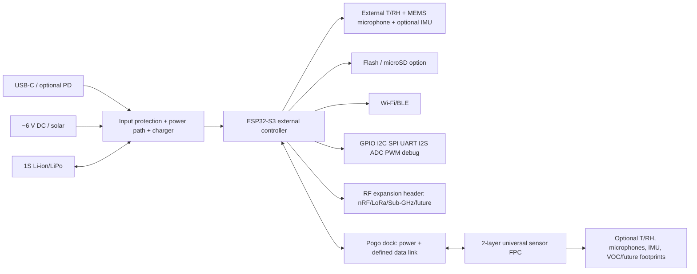

# 02 — System Architecture

## Functional architecture

## Boundaries and interfaces
| Boundary | Initial interface | Decision state |
|---|---|---|
| Input → PMIC | USB-C CC/VBUS, ~6 V DC/solar | USB-PD power contract TBD; do not assume 6 V is USB-PD |
| PMIC → logic | protected battery/system rail → TPS62161 3.3 V buck | V1 baseline; thermal/efficiency verification required |
| MCU → local sensors | I²C/SPI/I²S/GPIO | SHT45, ICS-43434 and optional ICM-42688-P baseline |
| MCU → dock | power plus I²C only for short, low-speed validated link, or differential bridge | blocking trade study |
| Dock → FPC | 12 pogo contacts plus Hirose FH34SRJ-12S-0.5SH(50) ZIF | V1 baseline; drawings/cycle test required |
| MCU → expansion | labelled headers/mezzanine, 3.3 V/GND/reset/enable/IRQ/GPIO | canonical map pending pin allocation |
| MCU → storage | SPI microSD option | DNP/populate decision during schematic review; event audio baseline sized for 32 GB class |

## Pilot versus scalable architecture
**Single-hive pilot:** one controller, one dock, one or more FPC variants in one bee box; prioritize safe attachment, logging, source transitions and researcher serviceability. **Scalable architecture:** preserve the same external board and universal FPC, add validated docks/FPCs and optional RF modules; multi-hive synchronization and enclosure certification are later scope.

## Data model recommendation
Each record should include device ID, FPC ID, sensor ID, UTC timestamp, monotonic sequence, sample rate, calibration revision, supply state, firmware version and quality flags. Time synchronization accuracy and offline buffering depth are client questions.

## V1 baseline resolution
The proposed one-bee-box baseline is documented in [23 Baseline Resolution](23_Baseline_Resolution_and_Schematic_Capture_Package.md): ESP32-S3-WROOM-1-N16R8 candidate; one internal SHT45, one ICS-43434 and one ICM-42688-P; 1S 2,000 mAh protected LiPo target; BQ24074-class power path; TPS62161 3.3 V buck; TCA9546A I²C branch isolation; 12-contact dock carrying 100 kHz I²C plus I²S. These are engineering baselines, not client-approved final selections.

## Decisions still requiring approval
Exact sensor MPN confirmation, pogo/FPC connector, battery mechanical part, enclosure, SD connector, RF expansion mechanical format, USB-PD requirement and solar operating envelope remain approval gates. See [06](06_Interface_and_Sensor_FPC_Guide.md), [14](14_Design_Readiness_Review.md), and [23](23_Baseline_Resolution_and_Schematic_Capture_Package.md).
> Navigation: [README](../README.md) · [Requirements](01_Project_Requirement_Analysis.md) · [Architecture](02_System_Architecture.md) · [BOM](04_BOM_Selection.md) · [Power](05_Power_Architecture.md) · [Interfaces](06_Interface_and_Sensor_FPC_Guide.md) · [DRR](14_Design_Readiness_Review.md)
