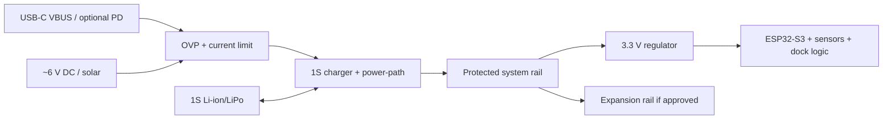

# 05 — Power Architecture

## Proposed topology (not frozen)

USB-PD is **not automatically necessary** for a 1-cell charger. Decide after the client specifies input voltage/current, solar behavior, desired charge time and whether negotiated power is actually required. A simple USB-C 5 V sink may be safer and cheaper; a PD sink is a separate architecture and firmware/configuration decision.

## Rails and protections
Define names `VBUS_USB`, `VIN_EXT`, `VBAT`, `VSYS`, `+3V3`, `VDOCK`, `VFPC`. Include input OVP/reverse protection, charger thermal regulation, battery protection (cell may be protected), load switching if needed, ESD at exposed connectors, and current/voltage test points. The charger/power-path IC must be selected from its datasheet—not a module assumption.

## Power budget (estimate method)
| Load | Typical | Peak / unknown | Basis |
|---|---:|---:|---|
| ESP32-S3 active/RF | TBD | RF burst TBD | exact module datasheet + measured firmware |
| local sensors | TBD | microphone/IMU mode TBD | selected datasheets |
| FPC sensors | TBD | populated combination dependent | sum selected MPNs |
| storage | TBD | write burst TBD | selected device |
| RF expansion | TBD | module-specific | module datasheet |
| regulator/charger loss | calculated | thermal limit | efficiency and voltage delta |

Do not publish a runtime as fact. Once average load `Iavg`, battery usable capacity `Cusable`, derating `D`, and conversion efficiency `η` are known: `runtime_h = Cusable_Ah × D × η / Iavg_A`. Test with Wi-Fi, logging, dock load and the worst supported FPC population. Charging thermal loss is approximately `(VIN−VBAT) × Icharge` for a linear path; measure case/PCB temperature and obey IC thermal limits.

## Required client inputs
Cell chemistry/protection, capacity, max continuous/peak current, connector, charge current/time, external input range and solar profile, enclosure airflow/ambient range, acceptable runtime, USB-PD requirement, and whether FPC sensors are powered continuously. See [15](15_Client_Clarification_Register.md).
> Navigation: [README](../README.md) · [Requirements](01_Project_Requirement_Analysis.md) · [Architecture](02_System_Architecture.md) · [BOM](04_BOM_Selection.md) · [Power](05_Power_Architecture.md) · [Interfaces](06_Interface_and_Sensor_FPC_Guide.md) · [DRR](14_Design_Readiness_Review.md)
