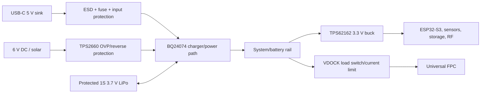

# 23 — Blocker Resolution and Baseline Schematic-Capture Package

**Revision:** 2026-10-12. This document establishes a technically justified V1 baseline for the one-bee-box pilot. It does not convert client questions into approvals or claim final manufacturing release.

## 1. Baseline decisions

| Blocker | Baseline resolution | Status |
|---|---|---|
| MCU | Espressif ESP32-S3-WROOM-1-N16R8, PCB antenna variant, 16 MB flash/8 MB octal PSRAM, nominal module body approximately 18 mm × 25.5 mm × 3.1 mm | PROVISIONAL — exact AVL/footprint confirmation required; R8 ambient rating and enclosure temperature must be checked |
| V1 FPC population | One SHT45 + one ICS-43434 + one ICM-42688-P; second T/RH, second microphone and SGP40 footprints DNI | RECOMMENDED; client approves research priorities |
| Battery | Protected 1S LiPo, nominal 3.7 V, 2,000 mAh target, ≥1 A continuous and ≥2 A transient capability, JST-PH or locking equivalent only after mechanical review | CLIENT APPROVAL REQUIRED |
| External input | USB-C 5 V sink baseline plus protected 6 V DC/solar input; USB-PD controller reserved, not populated in baseline | CLIENT APPROVAL REQUIRED because RFQ mentions USB-PD |
| Charger/path | TI BQ24074-class 1-cell charger/power-path candidate; charge current baseline 0.5 A | INVESTIGATE; thermal review required |
| Logic regulator | TI TPS62162 set to 3.3 V, 1 A class buck candidate | PROVISIONAL; exact efficiency/transient/thermal check required |
| Dock | 12-contact keyed pogo/FPC interface; 100 kHz I²C for environmental/IMU data plus I²S clock/data for the internal microphone | PROVISIONAL; physical SI and cycle validation required |
| Dock buffering | TCA4307-class hot-swap I²C buffer on controller side is an option; do not add until exact bus topology and capacitance are measured | INVESTIGATE |
| Audio | Internal microphone is event/window capture, not continuous raw audio by default; external microphone is separate local I²S channel | RECOMMENDED; research mode approval required |
| Status indication | Three low-current discrete 0603 LEDs, multiplexed for startup/charge/logging/connectivity/fault; no display or hive illumination | RETAIN |

## 2. ESP32-S3 baseline GPIO/peripheral map

This is a **draft map for ESP32-S3-WROOM-1-N16R8**, not a substitute for the exact module datasheet and Espressif hardware-design checklist. GPIOs used internally by flash/PSRAM, strapping pins and unavailable module pins must be confirmed against the exact module variant.

| GPIO | Baseline function | Peripheral | Access | Notes |
|---:|---|---|---|---|
| 0 | BOOT/ download | strapping | test pad/button | must not be driven incorrectly at reset |
| 1 | external T/RH interrupt | GPIO/ADC1_CH0 | test point | optional interrupt |
| 2 | battery divider sense | ADC1_CH1 | test point | divider must be switched or high value |
| 3 | spare/strap reserve | strapping | not assigned | reserve |
| 4 | main I²C SDA | I²C | expansion + local | 2.2 kΩ pull-ups at controller side |
| 5 | main I²C SCL | I²C | expansion + local | 2.2 kΩ pull-ups at controller side |
| 6 | SPI SCLK | SPI | SD/RF expansion | shared bus |
| 7 | SPI MOSI | SPI | SD/RF expansion | shared bus |
| 8 | SPI MISO | SPI | SD/RF expansion | shared bus |
| 9 | SD card CS | GPIO/SPI CS | test/expansion | SD optional |
| 10 | RF module CS | GPIO/SPI CS | RF header | optional |
| 11 | I²S BCLK | I²S | local + dock | source/drive review |
| 12 | I²S WS/LRCLK | I²S | local + dock | source/drive review |
| 13 | I²S SD input | I²S | external/internal microphones | shared audio input only if timing permits |
| 14 | RF expansion IRQ | GPIO interrupt | RF header | optional |
| 15 | RF reset | GPIO | RF header | optional |
| 16 | RF enable | GPIO | RF header | optional |
| 17 | RF UART RX | UART1 RX | RF header | optional |
| 18 | RF UART TX | UART1 TX | RF header | optional |
| 19 | USB D− | USB | USB-C | USB native function |
| 20 | USB D+ | USB | USB-C | USB native function |
| 21 | dock presence | GPIO interrupt | dock | pull-up/down defined in schematic |
| 38 | dock ID / FPC ID | ADC/GPIO | dock | resistor-coded ID option |
| 39 | expansion GPIO/IRQ | GPIO | expansion | spare |
| 40 | expansion GPIO | GPIO | expansion | spare |
| 41 | expansion GPIO/PWM | GPIO/MCPWM | expansion | spare |
| 42 | expansion GPIO/PWM | GPIO/MCPWM | expansion | spare |
| 43 | debug UART TX | UART0 TX | programming/header | default console |
| 44 | debug UART RX | UART0 RX | programming/header | default console |
| 45 | strapping reserve | strapping | not assigned | reserve |
| 46 | strapping/input-only reserve | strapping | not assigned | reserve |
| 47 | status LED red/green control | GPIO | local | multiplexed low-current LED drive |
| 48 | status LED blue/fault | GPIO | local | multiplexed low-current LED drive |

**Map limitations:** exact ESP32-S3 module pin exposure, flash/PSRAM reservations, USB/JTAG use, startup strapping, ADC attenuation and RF-module simultaneous use require pin-by-pin review against the selected module revision. The map is sufficient to begin a preliminary schematic sheet, not final release.

## 3. V1 sensor configuration

The one-box pilot should use:

- External SHT45 for ambient temperature/RH, physically remote from power and RF heat.
- External ICS-43434 for ambient acoustic reference.
- One internal SHT45 for hive micro-environment.
- One internal ICS-43434 for hive acoustic recording.
- One internal ICM-42688-P for vibration/motion context.
- Optional SGP40 footprint DNI for V1 unless the client specifically requires VOC data.

This combination measures temperature/RH, acoustic pressure waveform and inertial vibration. It does **not** directly measure bee movement or foraging; those are later interpretations requiring experiment design and ground truth.

The two SHT45 devices cannot share a single undifferentiated I²C segment if they use the same address. Use a TCA9546A four-channel I²C switch or separate sensor power/enable strategy; the baseline uses TCA9546A channels for local and dock/FPC branches. Exact addresses for every device must be confirmed from final datasheets.

## 4. Dock pinout baseline

| Pin | Signal | Purpose |
|---:|---|---|
| 1 | GND | return |
| 2 | GND | low impedance return |
| 3 | GND | signal return/contact redundancy |
| 4 | VDOCK | current-limited switched sensor supply |
| 5 | VDOCK | parallel power contact |
| 6 | +3V3_FPC | optional regulated local sensor rail |
| 7 | DOCK_SDA | 100 kHz I²C SDA |
| 8 | DOCK_SCL | 100 kHz I²C SCL |
| 9 | DOCK_BCLK | I²S bit clock for internal mic |
| 10 | DOCK_WS | I²S word select |
| 11 | DOCK_SD | I²S microphone data |
| 12 | DOCK_PRESENT/ID | presence and resistor-coded FPC ID |

Use **Hirose FH34SRJ-12S-0.5SH(50)** as the selected 12-position, 0.5 mm-pitch, 0.3 mm-FPC locking ZIF candidate for the permanently installed controller/FPC interface. Use a Mill-Max **0906-0-15-20-75-14-11-0** surface-mount spring contact as the pogo-contact candidate for the repeatedly detachable hub/hive interface; place pogo contacts on the controller docking face and use ENIG/gold-plated mating pads on the fixed dock/FPC carrier. Exact drawings, land patterns, stroke, force, resistance and cycle rating must be attached to the release package before layout. The Hirose ZIF is not repeatedly docked; the pogo array is.

Use asymmetric mechanical keying and magnets only for alignment, not as the sole polarity protection. Add connector-side ESD, VDOCK current limiting/load switching and a presence-controlled power sequence. Compare 50 mm, 100 mm and 200 mm installed FPC scenarios before layout; 100 mm is the provisional baseline. Client/mechanical confirmation is still required.

At 200 pF and 2.2 kΩ, the first-order 100 kHz rise time is 373 ns, below a 1 µs screening limit. I²S over the detachable interface remains **HARDWARE VALIDATION REQUIRED**; route clocks with a continuous return and provide a fallback configuration that disables the internal microphone if error testing fails.

## 5. Audio architecture and storage mode

The V1 recommendation is event-triggered raw audio clips plus periodic acoustic feature summaries. The external microphone and internal FPC microphone are separate roles but share the planned I²S signal group only through an explicit source-select/multiplexing decision; both microphones must not drive one data line simultaneously.

Baseline research mode: 16 kHz sample rate, 24-bit microphone words, mono, 5-second raw clips on an event trigger, maximum 12 clips/hour per microphone, plus 1-minute feature summaries (RMS, peak, band energies and event count). A 5-second clip is `16,000 × 24 × 5 / 8 = 240,000 bytes` raw, approximately 0.229 MiB before file metadata. At 12 clips/hour for 24 hours, raw clip storage is approximately 65.9 MiB/day per microphone. Feature summaries are negligible by comparison. A 32 GB card therefore provides substantial pilot margin if the firmware uses circular storage and file-integrity confirmation.

Continuous raw audio remains a separate scenario: 384 kb/s raw mono and approximately 4.83 GiB/day with the documented framing factor. It requires larger storage, higher sustained write bandwidth and materially shorter battery life. It is not the V1 default.

ICS-43434 is retained as the V1 digital I²S microphone candidate because it is compatible with a 3.3 V domain and avoids analog front-end noise, but microphone sensitivity/noise, acoustic port and environmental barrier must be checked against the final research bandwidth. The TCA9546A is an I²C address/branch switch; it does **not** transport or solve I²S audio.

## 6. Power architecture baseline

Baseline USB-C implementation is a 5 V sink with CC resistors. True USB-PD negotiation is not implemented until the client confirms that it is required; if required, add a PD sink controller and re-run input/thermal calculations. The approximately 6 V external input must pass OVP/reverse-polarity protection before the charger. A TVS/ESD part alone is not sufficient overvoltage protection.

## 6. Status indication

Use three discrete LEDs with 1 kΩ series resistors and firmware multiplexing:

- Green: startup/ready
- Amber effect: red + green together for charging
- Blue: logging/connectivity
- Red: fault

At assumed LED forward voltages of 1.9 V, 2.1 V and 2.8 V, currents are approximately 1.4 mA, 1.2 mA and 0.5 mA respectively at 3.3 V. Firmware limits duty cycle and prevents all channels from being continuously bright. This is a calculation using assumed Vf values; exact LED MPNs and maximum current must be verified. No display or internal hive light is included.

## 8. Kerala environmental design scenario

Kerala is treated as a high-humidity, monsoon-exposed pilot environment. The India Meteorological Department provides the authoritative national weather/climate source ([IMD](https://mausam.imd.gov.in/)); the World Bank Climate Change Knowledge Portal provides regional climate context ([India climate data](https://climateknowledgeportal.worldbank.org/country/india)). These sources do not define the customer's exact hive installation exposure, so the following are engineering scenarios, not verified product ratings:

- External controller design scenario: 20–35 °C ambient, 30–95% RH non-condensing, splash/short rain exposure possible, sun-heated enclosure scenario to be measured.
- Hive/FPC design scenario: 20–40 °C local air, high RH and condensation possible, wax/propolis/dust contamination possible, no assumption of IP rating until enclosure tests.
- Storage/transport scenario: supplier-rated component storage limits, not a field operating claim.

The weakest environmental links are the ESP32-S3 R8 module temperature class, sensor accuracy under condensation, microphone/acoustic port contamination, exposed pogo contacts, FPC adhesive/coverlay and connector ingress. Use a vented, hydrophobic membrane over environmental sensor openings only if it preserves response time/accuracy; keep microphones and sensor ports open to the measured environment; do not conformally coat sensing apertures, acoustic ports, ZIF contacts or pogo mating surfaces. Select gold-plated contacts, add strain relief, use a gasketed external controller enclosure and provide replaceable/cleanable sensor membranes where justified. This is an engineering recommendation, not a verified weatherproof or hive-qualified rating.

## 9. Mechanical baseline envelopes

These are explicitly provisional placement envelopes for an early 1:1 mockup, not client dimensions:

- Main PCB envelope: 60 mm × 40 mm maximum study rectangle.
- ESP32 module keepout: module body plus Espressif antenna keepout at one edge.
- Battery envelope: 45 mm × 25 mm × 8 mm maximum study envelope, off-board or underside.
- USB-C and dock: edge-mounted with retention and magnetic alignment hardware.
- External SHT45: remote vented pocket or short extension region at least 15 mm from charger/regulator/ESP32 heat sources in the initial study.
- FPC tail: 100 mm provisional electrical baseline; evaluate 50/100/200 mm scenarios, two-layer polyimide with connector stiffener; final length/bend radius from hive CAD and FPC vendor.
- Static bend: keep all components, vias and connector solder joints outside the dynamic bend; use fabricator-provided minimum static bend radius and a straight strain-relief transition. Do not release a numerical bend radius until the selected FPC stackup/vendor drawing is available.

These envelopes are sufficient for placement feasibility work but do not prove fit. Client must provide enclosure, mounting and hive interface geometry before final layout.

## 8. Schematic-capture decision

**Preliminary schematic capture is authorized** for the baseline sheets, with unresolved items labelled `DNI/TBD` and review gates. **Final schematic release is not authorized** until the exact ESP32 module ordering suffix, battery, connectors, external-input protection, client USB-PD decision, FPC mechanical envelope and V1 sensor acceptance criteria are approved.
